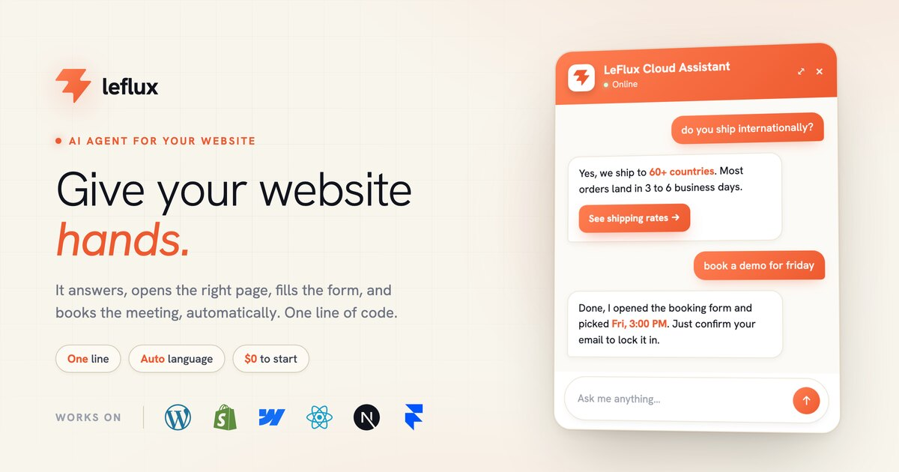

<p align="center">
  
</p>

<h1 align="center">LeFlux Docs</h1>

<p align="center">
  <strong>Your visitors ask. LeFlux does.</strong><br>
  Add AI chat to your website to answer from your public pages, guide visitors to the right page, assist with forms, and connect them with your team.
</p>

<p align="center">
  <a href="https://leflux.ai/">Website</a> ·
  <a href="https://leflux.ai/docs/">Documentation</a> ·
  <a href="https://github.com/PocketSystems/leflux-docs/issues">Report an issue</a>
</p>

<p align="center">
  
  
</p>

---

## What is LeFlux?

LeFlux is a JavaScript widget you add to your website. Visitors chat in natural language. The agent uses your site's public pages to answer questions, helps visitors navigate, assists with supported forms, and can hand a conversation to your team.

Add your site in the dashboard, then install the widget:

```html
<script src="https://leflux.ai/embed.js" async></script>
```

The script does not need a public API key. Your domain and allowed hosts must be configured in the dashboard first. See the [installation and testing guide](https://leflux.ai/docs/guides/ai-chat-for-website/).

## Works on every platform

Same one line, whatever you built with.


Plus any custom stack. Find the install guides in the [docs](https://leflux.ai/docs/).

## What it does

- **Universal indexing** so the agent references elements by id, not brittle CSS selectors, and works on any site.
- **Knowledge base** built by a crawler that walks your site, so answers come from your content first.
- **Action execution** for click, type, scroll, navigate, and select, composed into multi-step workflows.
- **Form auto-fill** that asks for missing values one at a time, then fills and submits in one atomic step.
- **Multi-language** detection every message, mirroring the visitor's language.
- **Three layouts**: floating bubble, bottom-bar pill, and dockable side panel.

## This repository

This is the source for the LeFlux documentation site, served live at **[leflux.ai/docs](https://leflux.ai/docs/)**. It is built with [Astro Starlight](https://starlight.astro.build).

### Local development

```bash
cd docs-site
npm install
npm run dev
```

The docs build and deploy automatically on every push to `main`.

## Found a bug or have a feature request?

Please open it here: **[github.com/PocketSystems/leflux-docs/issues](https://github.com/PocketSystems/leflux-docs/issues)**

That is the right place for anything LeFlux related: docs fixes, widget bugs, integration questions, or feature ideas. We read every one.

---

<p align="center">
  <a href="https://leflux.ai/">leflux.ai</a>
</p>
